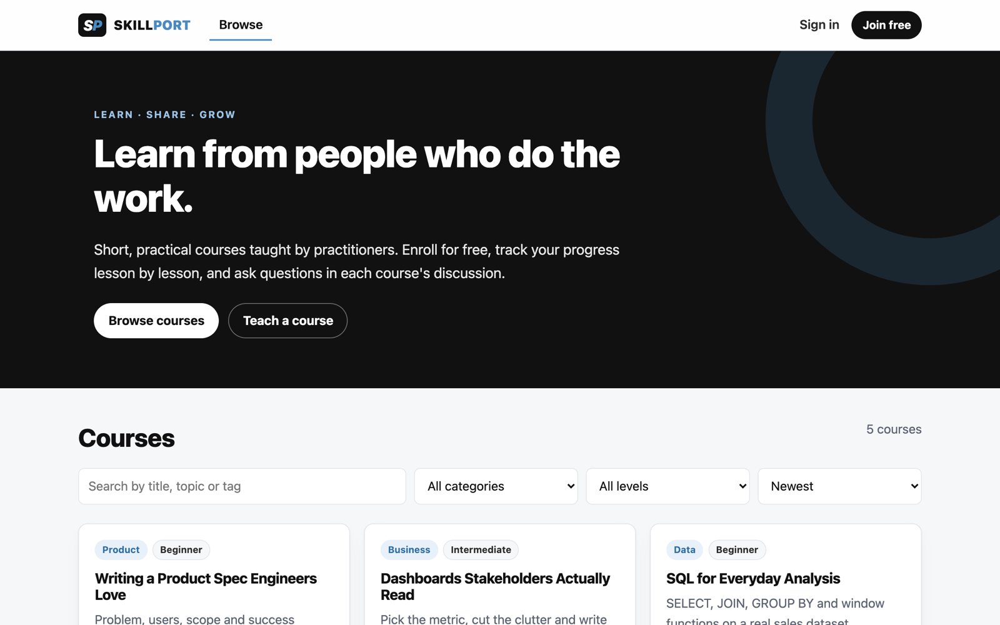
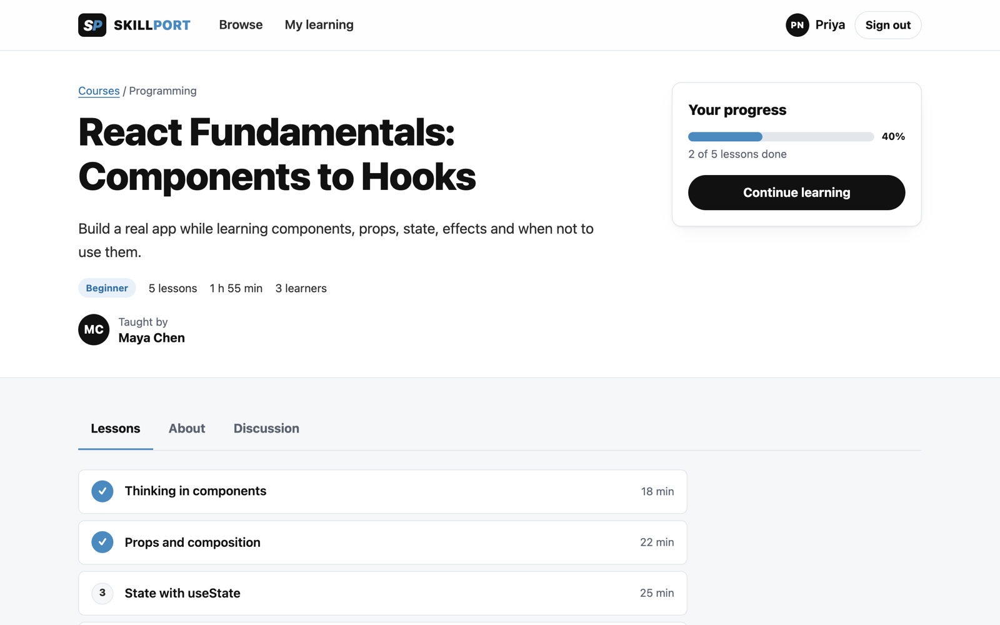
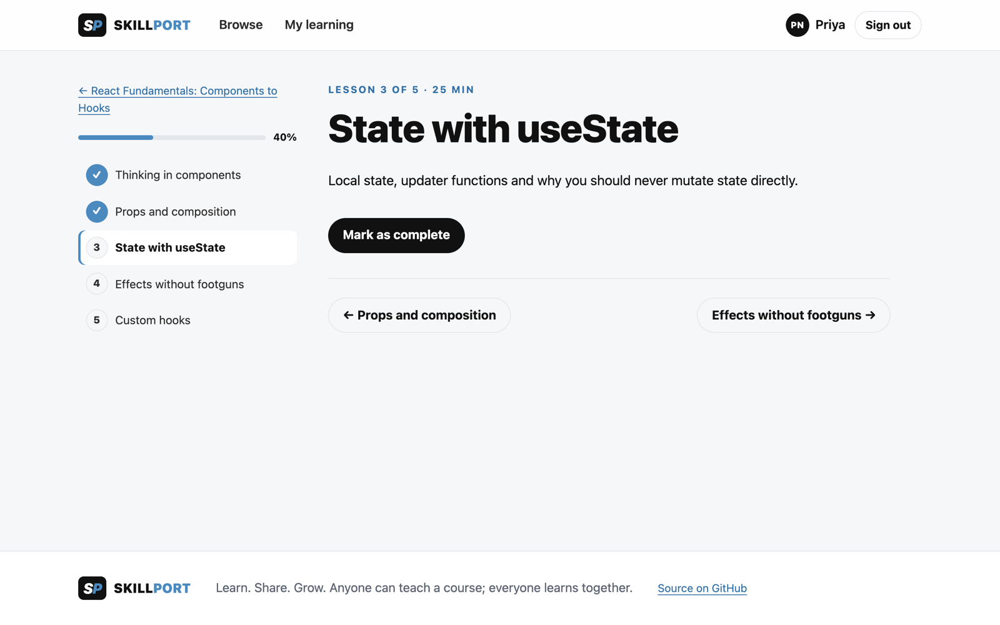
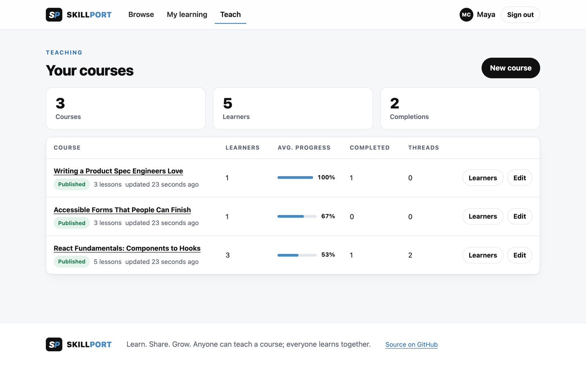
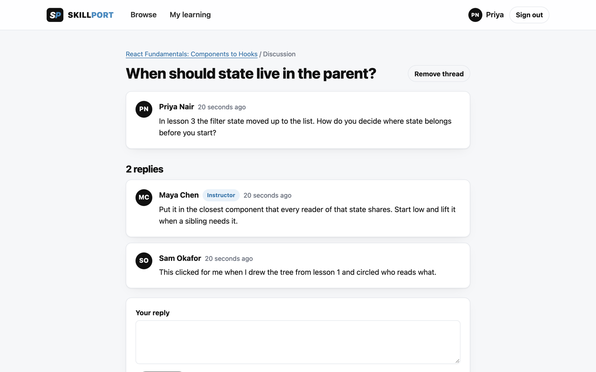

<p align="center"></p>

# SkillPort

**A peer-to-peer learning platform: anyone can teach a short course, and learners enroll, track their progress lesson by lesson and discuss the course together.**



SkillPort v2 is a ground-up rebuild of my original 2024 prototype. v1 never ran end to end (the server crashed on start and half the screens pointed at routes that didn't exist), so v2 keeps the idea and the MERN stack, and makes every feature the README promises actually work, with tests. See [CHANGELOG.md](CHANGELOG.md) for exactly what changed.

## What you can do

| Learners | Instructors |
| --- | --- |
| Browse, search and filter the catalog (category, level, newest / most learners / A–Z) | Create a course with any number of lessons; reorder, edit and remove lessons |
| Preview any course's outline, then enroll for free | Save as a draft (visible only to you) and publish when it has at least one lesson |
| Read lessons and mark them complete; progress is saved per lesson | See every course you teach with learners, average progress, completions and threads |
| Pick up where you left off from **My learning** (next lesson, last opened) | Drill into one course to see each learner's progress and last activity |
| Download a PDF certificate when every lesson is done | Answer questions in your course discussions (replies are marked **Instructor**) |
| Ask questions and reply in each course's discussion | Remove off-topic threads in your courses |

Everyone gets a profile (name, headline, bio) and a public page listing the courses they teach.

| | |
| --- | --- |
|  |  |
|  |  |

## Quick start

You need **Node.js 20+** and **MongoDB** running locally (or a connection string to one).

```bash
git clone https://github.com/AdityaHasija37/SkillPort.git
cd SkillPort
npm install
cp server/.env.example server/.env   # then set JWT_SECRET to a long random string
npm run seed                         # demo courses, people and discussions
npm run dev                          # API on :5000, web app on http://localhost:5173
```

No MongoDB installed? `docker run -d -p 27017:27017 mongo:8` works with the default `MONGODB_URI`.

**Demo accounts** (all use the password `skillport-demo`):

| Email | Role | Has |
| --- | --- | --- |
| `maya@skillport.dev` | Instructor | 3 courses, learners at different stages |
| `rohan@skillport.dev` | Instructor | 2 published courses and a draft |
| `priya@skillport.dev` | Learner | 2 courses in progress, 1 completed (certificate ready) |
| `sam@skillport.dev`, `lena@skillport.dev` | Learners | Enrollments and discussion posts |

## Scripts

| Command | What it does |
| --- | --- |
| `npm run dev` | API (with `--watch`) and Vite dev server together |
| `npm run seed` | Reset the database to the demo data |
| `npm test` | API tests against an in-memory MongoDB, then the client tests |
| `npm run lint` | ESLint for both workspaces |
| `npm run build` | Production build of the web app to `client/dist` |
| `npm start` | Run the API in production mode |

## Tech stack

- **Web:** React 18, React Router 6, Vite 6, hand-written CSS with design tokens (light and dark mode, no UI framework)
- **API:** Node 20+, Express 5, Mongoose 8 on MongoDB, Zod validation, JWT auth with bcrypt, Helmet, rate-limited sign-in, PDFKit certificates
- **Quality:** Vitest + Supertest + mongodb-memory-server (25 API tests), Vitest + Testing Library (7 UI tests), ESLint, GitHub Actions CI

## Project layout

```
SkillPort/
├── client/                 React app (Vite)
│   └── src/
│       ├── pages/          one file per screen
│       ├── components/     layout, shared UI, route guard
│       └── lib/            API client, auth context, hooks, formatting
├── server/                 Express API
│   ├── src/
│   │   ├── routes/         auth, me, users, courses, threads, instructor
│   │   ├── models/         User, Course (with lessons), Enrollment, Thread
│   │   ├── middleware/     auth (JWT, roles) and error handling
│   │   ├── lib/            validation schemas, access rules, serializers, certificate
│   │   └── seed.js         demo data
│   └── test/               API tests
└── docs/                   product brief, architecture, API, decisions, screenshots
```

## Documentation

- [Product brief](docs/PRODUCT.md): the problem, who it's for, scope, and what success looks like
- [Architecture](docs/ARCHITECTURE.md): data model, access rules and request flow
- [API reference](docs/API.md): every endpoint, with who may call it
- [Decisions](docs/DECISIONS.md): the trade-offs behind v2 and what's deliberately out of scope
- [Changelog](CHANGELOG.md)
- [Original v1 README](docs/archive/v1-README.md)

## Roadmap

Ideas from v1 that are still worth doing, in rough priority order: paid courses (Stripe), notifications when someone replies to your thread, lesson attachments and video, course reviews and ratings, and richer instructor analytics (drop-off by lesson).
